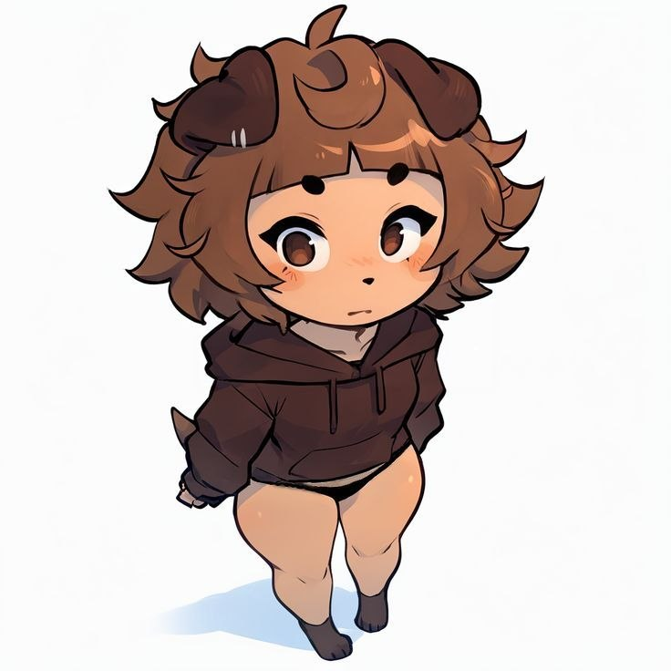

<h1 align="center">Mikhail Khodyrev</h1>

  <b>Unity GameDev</b> · делаю игры · making games

  <a href="https://t.me/mshgn4zzz">Telegram</a> ·
  <a href="mailto:mishakhodyrev0@gmail.com">Email</a> ·
  <a href="https://vk.ru/otec_glinomes83">VK</a>

---

  

  <picture>
    <source media="(prefers-color-scheme: dark)"
            srcset="https://raw.githubusercontent.com/otecGlinomes83/otecGlinomes83/output/github-contribution-grid-snake-dark.svg"/>
    <source media="(prefers-color-scheme: light)"
            srcset="https://raw.githubusercontent.com/otecGlinomes83/otecGlinomes83/output/github-contribution-grid-snake.svg"/>
    
  </picture>

---

## Проекты / Projects

| Проект / Project | О чём / About |
| --- | --- |
| [**Mad-Slime**](https://github.com/otecGlinomes83/Mad-Slime) | бузмный слайм · a rowdy slime |
| [**MazeHell**](https://github.com/otecGlinomes83/MazeHell) | лабиринты и страдания · mazes & suffering |
